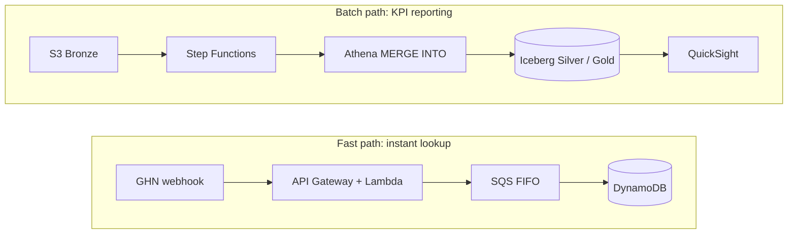
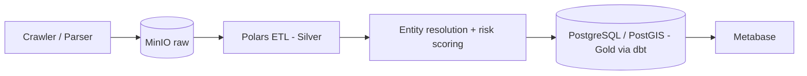
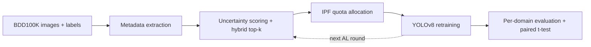

<picture>
  <source media="(prefers-color-scheme: dark)" srcset="assets/banner-dark.svg">
  
</picture>

&nbsp;

 

&nbsp;
&nbsp;

## About

Data Engineering student at HCMC University of Technology and Education (HCMUTE), focused on building reliable data pipelines and lakehouse architectures. Currently looking for internship and entry-level opportunities in Data Engineering, with a secondary interest in Data Analytics and Computer Vision.

## Experience

| Period | Role | Organization |
|---|---|---|
| Oct 2026 – Dec 2026 | **Data Engineer Intern** | AWS |
| Sep 2026 – Nov 2026 | **Data Analyst Intern** (remote) | QT-DATA VN |

**Certification:** Samsung, Big Data 2024-2025

## Tech Stack

| Area | Tools |
|---|---|
| **Languages** |   |
| **Cloud & Lakehouse** |         |
| **Processing & Transformation** |    |
| **Databases** |   |
| **BI** |   |
| **ML & CV** |    |
| **DevOps & IaC** |    |

## Featured Projects

### 1. [AWS Serverless Data Lakehouse for Logistics Orders](https://github.com/nguyendinhtanloc-Org/aws-workshop)
**Data Engineering** · Team of 5 · I owned the lakehouse layer

A dual-path serverless lakehouse for e-commerce orders shipped via GHN. Orders change status 5–7 times (with re-delivery loops and out-of-order events), so one path serves instant lookups while the other merges into Apache Iceberg tables for KPI reporting, without running Spark clusters.

| Scale target | Fast-path latency target | Gold KPIs |
|:---:|:---:|:---:|
| **30,000+** orders/day | **< 15 ms** | **4** (first-attempt delivery, return rate, on-time delivery, lead time) |

<b>Architecture and highlights</b>

- Window-function pre-dedup before every `MERGE` to prevent cardinality violations
- Gold mart `delivery_kpis`, built by Step Functions: merge events → merge orders → daily aggregation
- Scheduled `OPTIMIZE` (bin-pack) and `VACUUM` via EventBridge to control small files and storage cost
- My part: Iceberg DDL (Medallion), Athena MERGE SQL, Step Functions orchestration, table maintenance

`Apache Iceberg` `Athena` `Step Functions` `Glue` `DynamoDB` `AWS CDK`

### 2. [PropMatch Engine: Real Estate Entity Resolution](https://github.com/nguyendinhtanloc-Org/propmatch-engine)
**Data Engineering** · Solo project · *In progress*

A local-first pipeline that deduplicates Vietnamese rental listings posted across multiple platforms, with a zero-false-merge rule for the Gold layer, plus risk scoring and spatial price analytics.

| Candidate recall (target) | Pairwise F1 (target) | False merges into Gold |
|:---:|:---:|:---:|
| **≥ 85%** (synthetic set) | **≥ 70%** (human-labeled set) | **0** (design rule) |

<b>Architecture and highlights</b>

- Multi-pass blocking with overlapping buckets to shrink the matching space without losing edge cases
- Graph clustering with conflict-driven refinement: clusters split when locations conflict by more than 500 m
- Commit markers on MinIO for idempotent, integrity-safe runs
- Dimensional modeling in dbt, spatial queries with PostGIS, dashboards in Metabase

`Python` `Polars` `NetworkX` `PostGIS` `dbt` `MinIO` `Docker`

### 3. [Metadata-Stratified Active Learning for Object Detection](https://github.com/nguyendinhtanloc-Org/metadata-stratified-active-learning)
**Computer Vision** · Independent research thesis

Uncertainty-based active learning tends to pick familiar daytime images and miss rare conditions. This project stratifies sampling by scene metadata (weather, scene, time of day) and allocates the labeling budget across strata with Iterative Proportional Fitting, then retrains YOLOv8 on BDD100K (~61,800 unlabeled images, 2,000-image fixed evaluation set).

| Adverse-weather mAP50 | Batch diversity (entropy) | Unit tests |
|:---:|:---:|:---:|
| **0.3430** vs 0.3223 baseline (+2.1 pts) | **3.70 → 5.06** bits (p < 0.005, Cohen's d = 9.71) | **43 / 43** passing |

<b>Pipeline and highlights</b>

- End to end: method design, modular code (`sampling`, `active_learning`, `analysis`, `metrics`), experiments on Kaggle GPU, statistical analysis
- Tests cover sample-count conservation, IPF convergence tolerance and exhausted-pool fallback

`PyTorch` `YOLOv8` `SciPy` `pytest` `Docker`

<!-- 4. Data Analytics project: to be added -->

---

Open to Data Engineering internships and entry-level roles

