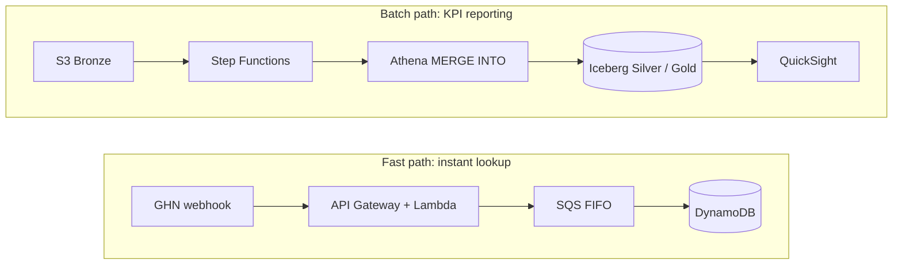
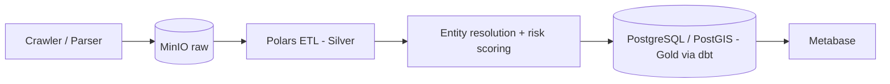
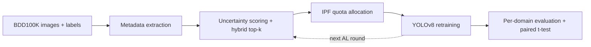

  

  &nbsp;
  
    
  &nbsp;
  &nbsp;
  

 

## About

Data Engineering student at **HCMC University of Technology and Education (HCMUTE)**, focused on building reliable, scalable data pipelines and lakehouse architectures. Currently looking for **internship and entry-level opportunities in Data Engineering**, with strong secondary capabilities in **Data Analytics** and **Computer Vision**.

- **Core Focus:** Serverless Data Lakehouse, Real-time/Batch ETL Pipelines, Spatial Analytics, and Entity Resolution.
- **Certification:** Samsung Innovation Campus — Big Data (2024–2025).

---

## Experience

| Period | Role | Organization | Focus Area |
| :--- | :--- | :--- | :--- |
| **Sep 2026 – Oct 2026** | **Data Analyst Intern** *(Remote)* | **QT-DATA VN** | Data modeling, KPI reporting, BI dashboards |
| **Oct 2026 – Dec 2026** | **Data Engineer Intern** | **AWS** | Serverless Lakehouse, Apache Iceberg, Step Functions orchestration |

---

## Tech Stack

| Category | Technologies |
| :--- | :--- |
| **Languages** |   |
| **Cloud & Lakehouse** |         |
| **Processing & Transformation** |    |
| **Databases** |   |
| **BI & Analytics** |   |
| **ML & Computer Vision** |    |
| **DevOps & IaC** |    |

---

## Featured Projects

### 1. [AWS Serverless Data Lakehouse for Logistics Orders](https://github.com/nguyendinhtanloc-Org/aws-workshop)
> **Data Engineering** · Team of 5 · *Owned the Lakehouse & Orchestration Layer*

A dual-path serverless lakehouse for e-commerce orders shipped via GHN. Because orders change status 5–7 times (with re-delivery loops and out-of-order events), one path serves instant lookups while the other merges into **Apache Iceberg** tables for KPI reporting—without running Spark clusters.

| Scale Target | Fast-Path Latency Target | Gold KPIs |
| :---: | :---: | :---: |
| **30,000+** orders/day | **< 15 ms** | **4** *(First-attempt delivery, Return rate, On-time delivery, Lead time)* |

<b>Architecture and engineering highlights</b>

 

- **Pre-deduplication:** Window-function pre-dedup before every `MERGE` to prevent cardinality violations.
- **Orchestration:** Gold mart `delivery_kpis`, built by Step Functions: `merge events` → `merge orders` → `daily aggregation`.
- **Table Maintenance:** Scheduled `OPTIMIZE` (bin-pack) and `VACUUM` via EventBridge to control small files and storage cost.
- **Scope of Ownership:** Iceberg DDL (Medallion), Athena MERGE SQL, Step Functions orchestration, and table maintenance.

`Apache Iceberg` `Athena` `Step Functions` `Glue` `DynamoDB` `AWS CDK`

---

### 2. [PropMatch Engine: Real Estate Entity Resolution](https://github.com/nguyendinhtanloc-Org/propmatch-engine)
> **Data Engineering** · Solo Project · *In Progress*

A local-first pipeline that deduplicates Vietnamese rental listings posted across multiple platforms, enforcing a **zero-false-merge rule** for the Gold layer, plus risk scoring and spatial price analytics.

| Candidate Recall (Target) | Pairwise F1 (Target) | False Merges into Gold |
| :---: | :---: | :---: |
| **≥ 85%** *(synthetic set)* | **≥ 70%** *(human-labeled set)* | **0** *(design rule)* |

<b>Architecture and engineering highlights</b>

 

- **Multi-pass Blocking:** Designed overlapping buckets to shrink the matching space without losing boundary edge cases.
- **Conflict-driven Graph Clustering:** Clusters automatically split when geospatial locations conflict by more than 500 m.
- **Idempotency:** Commit markers on MinIO for idempotent, integrity-safe pipeline runs.
- **Analytics & BI:** Dimensional modeling in `dbt`, spatial queries with `PostGIS`, and interactive dashboards in `Metabase`.

`Python` `Polars` `NetworkX` `PostGIS` `dbt` `MinIO` `Docker`

---

### 3. [Metadata-Stratified Active Learning for Object Detection](https://github.com/nguyendinhtanloc-Org/metadata-stratified-active-learning)
> **Computer Vision** · Independent Research Thesis

Uncertainty-based active learning tends to pick familiar daytime scenes and miss rare conditions. This project stratifies sampling by scene metadata (weather, scene, time of day) and allocates the labeling budget across strata with **Iterative Proportional Fitting (IPF)**, then retrains **YOLOv8** on BDD100K (~61,800 unlabeled images, 2,000-image fixed evaluation set).

| Adverse-Weather mAP50 | Batch Diversity (Entropy) | Unit Tests |
| :---: | :---: | :---: |
| **0.3430** vs 0.3223 baseline *(+2.1 pts)* | **3.70 → 5.06** bits *(p < 0.005, Cohen's d = 9.71)* | **43 / 43** passing |

<b>Pipeline and research highlights</b>

 

- **End-to-End Implementation:** Method design, modular code (`sampling`, `active_learning`, `analysis`, `metrics`), experiments on Kaggle GPU, and statistical validation.
- **Test Coverage:** Automated tests verify sample-count conservation, IPF convergence tolerance, and exhausted-pool fallback.

`PyTorch` `YOLOv8` `SciPy` `pytest` `Docker`

---

## GitHub Activity

  
  

 

  <b>Open to Data Engineering Internships and Entry-Level Roles</b>

