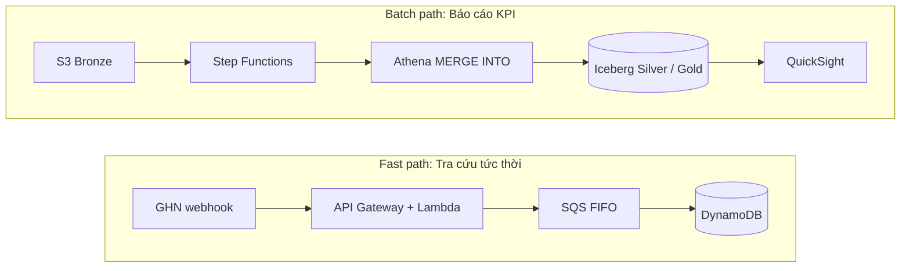
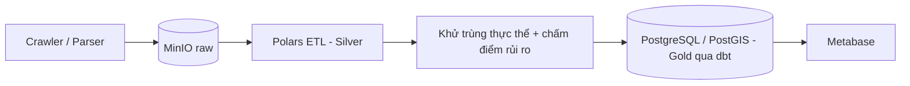
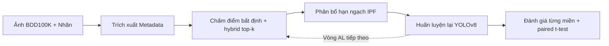

  

  &nbsp;
  
    
  &nbsp;
  &nbsp;
  

 

## Giới thiệu

Sinh viên ngành Kỹ thuật Dữ liệu (Data Engineering) tại **Trường Đại học Sư phạm Kỹ thuật TP.HCM (HCMUTE)**, tập trung xây dựng các data pipeline ổn định, có khả năng mở rộng và kiến trúc lakehouse. Hiện đang tìm kiếm **cơ hội thực tập và vị trí entry-level về Data Engineering**, đồng thời có thế mạnh bổ trợ về **Data Analytics** và **Computer Vision**.

- **Trọng tâm chuyên môn:** Serverless Data Lakehouse, ETL Pipeline thời gian thực/theo lô, Phân tích không gian địa lý (Spatial Analytics) và Khử trùng thực thể (Entity Resolution).
- **Chứng chỉ:** Samsung Innovation Campus — Big Data (2024–2025).

---

## Kinh nghiệm

| Thời gian | Vị trí | Đơn vị | Lĩnh vực trọng tâm |
| :--- | :--- | :--- | :--- |
| **09/2026 – 10/2026** | **Data Analyst Intern** *(Remote)* | **QT-DATA VN** | Mô hình hóa dữ liệu, báo cáo KPI, dashboard BI |
| **10/2026 – 12/2026** | **Data Engineer Intern** | **AWS** | Serverless Lakehouse, Apache Iceberg, điều phối Step Functions |

---

## Công nghệ sử dụng

| Lĩnh vực | Công cụ |
| :--- | :--- |
| **Ngôn ngữ** |   |
| **Cloud & Lakehouse** |         |
| **Xử lý & Biến đổi dữ liệu** |    |
| **Cơ sở dữ liệu** |   |
| **BI & Phân tích** |   |
| **ML & Computer Vision** |    |
| **DevOps & IaC** |    |

---

## Dự án nổi bật

### 1. [AWS Serverless Data Lakehouse cho đơn hàng logistics](https://github.com/nguyendinhtanloc-Org/aws-workshop)
> **Data Engineering** · Nhóm 5 người · *Phụ trách tầng Lakehouse & Điều phối dữ liệu*

Data lakehouse serverless hai luồng cho đơn hàng thương mại điện tử vận chuyển qua GHN. Do đơn hàng đổi trạng thái 5–7 lần (kèm vòng lặp giao lại và sự kiện đến sai thứ tự), hệ thống tách thành hai nhánh: một luồng phục vụ tra cứu tức thời và một luồng hợp nhất (merge) vào bảng **Apache Iceberg** phục vụ báo cáo KPI mà không cần vận hành cụm Spark.

| Quy mô thiết kế | Độ trễ luồng tra cứu nhanh | Chỉ số Gold KPIs |
| :---: | :---: | :---: |
| **30.000+** đơn/ngày | **< 15 ms** | **4** *(Tỷ lệ giao lần đầu, Tỷ lệ hoàn, Giao đúng hạn, Lead time)* |

<b>Kiến trúc và điểm nhấn kỹ thuật</b>

 

- **Chống trùng lặp (Pre-deduplication):** Lọc trùng bằng window function trước mỗi lệnh `MERGE` để ngăn lỗi cardinality violation.
- **Điều phối (Orchestration):** Xây dựng Gold mart `delivery_kpis` qua Step Functions theo luồng: `merge events` → `merge orders` → `tổng hợp theo ngày`.
- **Bảo trì bảng:** Tự động hóa lịch chạy `OPTIMIZE` (gom file nhỏ - bin-pack) và `VACUUM` qua EventBridge để tối ưu chi phí lưu trữ và tốc độ truy vấn.
- **Phạm vi đảm nhận:** Thiết kế Iceberg DDL (Medallion), viết truy vấn Athena MERGE SQL, điều phối Step Functions và bảo trì bảng.

`Apache Iceberg` `Athena` `Step Functions` `Glue` `DynamoDB` `AWS CDK`

---

### 2. [PropMatch Engine: Khử trùng thực thể bất động sản](https://github.com/nguyendinhtanloc-Org/propmatch-engine)
> **Data Engineering** · Dự án cá nhân · *Đang thực hiện*

Pipeline chạy local-first giúp khử trùng các tin cho thuê nhà đăng lặp trên nhiều nền tảng tại Việt Nam, tuân thủ nguyên tắc **zero false merge** (không gộp nhầm) ở tầng Gold, kết hợp chấm điểm rủi ro và phân tích giá theo không gian địa lý.

| Candidate Recall (Mục tiêu) | Pairwise F1 (Mục tiêu) | Tỷ lệ gộp nhầm vào Gold |
| :---: | :---: | :---: |
| **≥ 85%** *(tập dữ liệu synthetic)* | **≥ 70%** *(tập gán nhãn thủ công)* | **0** *(nguyên tắc thiết kế)* |

<b>Kiến trúc và điểm nhấn kỹ thuật</b>

 

- **Multi-pass Blocking:** Thiết kế các nhóm phân vùng chồng lấn (overlapping buckets) để thu hẹp không gian đối sánh mà không làm rơi các trường hợp biên.
- **Phân cụm đồ thị giải quyết xung đột:** Tự động tách cụm thực thể khi tọa độ địa lý mâu thuẫn vượt quá 500 m.
- **Đảm bảo tính lũy đẳng (Idempotency):** Sử dụng commit marker trên MinIO giúp pipeline chạy lại an toàn và toàn vẹn dữ liệu.
- **Phân tích & BI:** Mô hình hóa dữ liệu đa chiều bằng `dbt`, truy vấn không gian với `PostGIS` và trực quan hóa trên `Metabase`.

`Python` `Polars` `NetworkX` `PostGIS` `dbt` `MinIO` `Docker`

---

### 3. [Metadata-Stratified Active Learning cho Object Detection](https://github.com/nguyendinhtanloc-Org/metadata-stratified-active-learning)
> **Computer Vision** · Đề tài nghiên cứu độc lập

Phương pháp active learning dựa trên độ bất định truyền thống thường ưu tiên các ảnh ban ngày quen thuộc và bỏ sót các điều kiện hiếm gặp. Dự án này phân tầng lấy mẫu theo metadata bối cảnh (thời tiết, khung cảnh, thời điểm trong ngày), phân bổ hạn ngạch gán nhãn bằng **Iterative Proportional Fitting (IPF)**, sau đó huấn luyện lại **YOLOv8** trên bộ dữ liệu BDD100K (~61.800 ảnh chưa gán nhãn, tập đánh giá cố định 2.000 ảnh).

| mAP50 điều kiện thời tiết xấu | Độ đa dạng batch (Entropy) | Kiểm thử đơn vị (Unit Tests) |
| :---: | :---: | :---: |
| **0.3430** so với 0.3223 baseline *(+2.1 điểm)* | **3.70 → 5.06** bits *(p < 0.005, Cohen's d = 9.71)* | **43 / 43** đạt |

<b>Quy trình và điểm nhấn nghiên cứu</b>

 

- **Triển khai toàn diện (End-to-End):** Thiết kế phương pháp, tổ chức mã nguồn dạng module (`sampling`, `active_learning`, `analysis`, `metrics`), chạy thực nghiệm trên Kaggle GPU và kiểm định thống kê.
- **Độ tin cậy mã nguồn:** Hệ thống unit test tự động kiểm tra bảo toàn số lượng mẫu, sai số hội tụ IPF và cơ chế dự phòng khi cạn kiệt dữ liệu.

`PyTorch` `YOLOv8` `SciPy` `pytest` `Docker`

---

## Hoạt động GitHub

  

 

  <b>Sẵn sàng cho các cơ hội thực tập và vị trí Entry-Level về Data Engineering</b>

